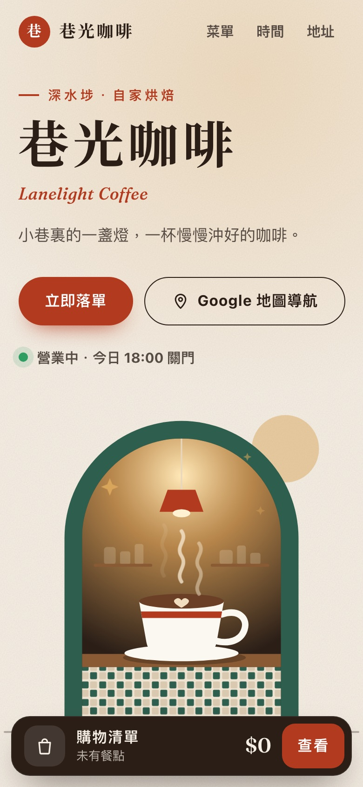
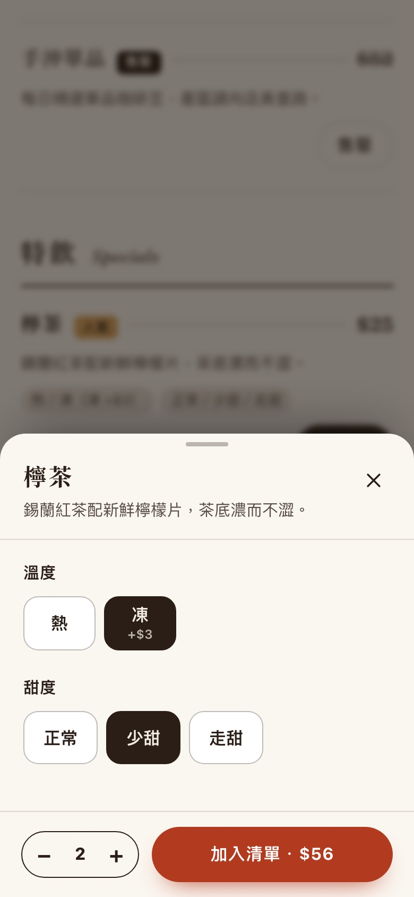
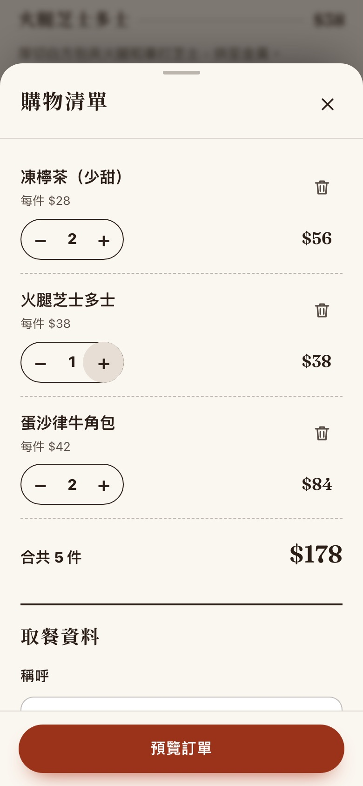
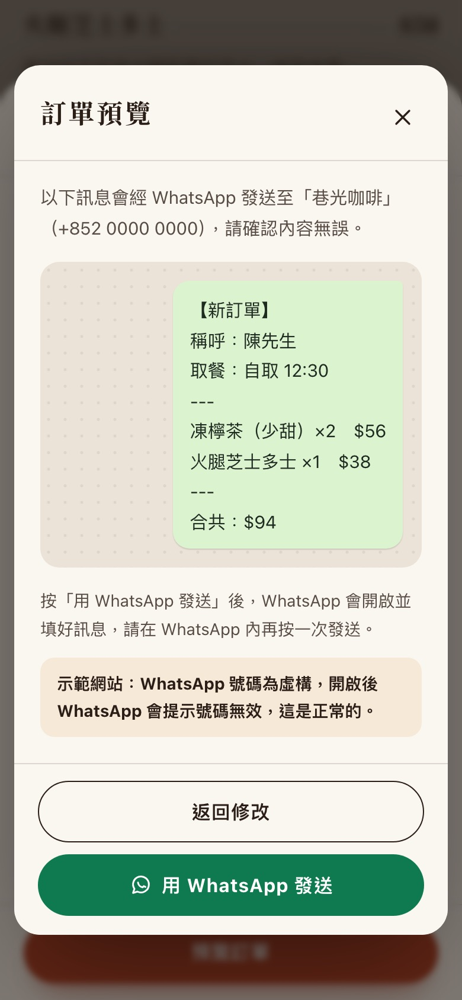

# 巷光咖啡｜香港小店一頁式網站（WhatsApp 落單）

> **示範作品・店名及內容純屬虛構。** 這是一個可重複使用的模板：換一個設定檔，就能變成另一間店的網站。

線上示範：<https://nethken284-debug.github.io/hk-cafe-whatsapp-demo/>

| 手機版 | 選項 | 購物清單 | 訂單預覽 |
| --- | --- | --- | --- |
|  |  |  |  |


---

## 功能

- 一頁式：首屏、關於我們、菜單（分類＋捲動時自動標示）、營業時間（自動顯示「營業中／休息中」）、地址及聯絡、頁尾
- **WhatsApp 落單**
  - 菜單每項可「加入」及加減數量；支援選項及加價（例如熱／凍，凍 +$3；少甜／正常）
  - 可標記「售罄」，售罄項目不能加入
  - 底部固定購物清單列，可查看明細、改數量、刪除
  - 取餐資料：稱呼、自取（日期＋時間）或堂食（枱號）、備註
  - 檢查：清單不能是空的；自取時間必須在營業時間內，而且最少比現在晚 N 分鐘（以香港時間計算）
  - 發送前先顯示「訂單預覽」，確認後以 `https://wa.me/<號碼>?text=<訊息>` 開啟 WhatsApp（手機開 App，電腦開 WhatsApp Web）
  - 價錢一律用整數計算；購物清單存於瀏覽器（localStorage），重新整理不會消失
  - 整個落單功能可以一鍵關閉
- 手機優先設計，按鈕最少 44px 高；沒有框架、不需要後端
- Lighthouse（手機模式）：效能 100、無障礙 100、最佳做法 100

訊息例子：

```
【新訂單】
稱呼：陳先生
取餐：自取 12:30
---
凍檸茶（少甜）×2　$56
火腿芝士多士 ×1　$38
---
合共：$94
```

## 檔案結構

```
config.js                 ← 店舖設定檔（換店只需要改這個）
index.html                ← 頁面骨架（一般不用改）
assets/
  styles.css              ← 樣式
  core.js                 ← 計價、營業時間、訊息格式等核心邏輯
  site.js                 ← 按設定檔產生頁面內容
  order.js                ← WhatsApp 落單介面
  og-image.jpg            ← 分享預覽圖（每間店一張）
build.js                  ← 建置腳本：產生 dist/（部署用）
deploy-github-pages.sh    ← 一鍵部署到 GitHub Pages
tools/og-card.html        ← 分享預覽圖產生器
tests/core.test.js        ← 自動測試
```

需要的工具只有 [Node.js](https://nodejs.org/) 18 或以上（建置及測試用），不需要安裝其他套件。

---

## 換成新店舖（只改 config.js，再執行建置）

1. **複製一份這個倉庫**：在 GitHub 按「Fork」，或下載 ZIP 後放到新資料夾。
2. **修改 `config.js`**：每一項旁邊都有中文說明，主要包括：

   | 項目 | 說明 |
   | --- | --- |
   | `id` | 店舖英文代號，每間店不同（例如 `"tung-kee-bakery"`） |
   | `demo` | 示範網站用 `true`；**真實客戶一定要改為 `false`** |
   | `name`、`nameEn`、`kicker`、`tagline`、`description` | 店名、英文名、首屏小字、標語、介紹 |
   | `share` | 分享預覽：網站網址 `siteUrl`、預覽圖 `image` |
   | `about` | 關於我們的段落及特色標籤 |
   | `theme` | 主色、輔助色、文字色、底色 |
   | `hours` | 營業時間（`days` 用 0＝星期日 … 6＝星期六） |
   | `contact` | 地址、交通、Google 地圖連結、電話、WhatsApp、Instagram |
   | `order` | 落單開關、自取／堂食、最少提前分鐘數、可預訂日數 |
   | `optionGroups` | 選項及加價（溫度、甜度等） |
   | `menu` | 菜單分類及項目：名稱、價錢（整數）、描述、選項、售罄、標籤 |

3. **換分享預覽圖**（在 WhatsApp、Facebook、Carousell 貼連結時顯示的圖片），二選一：
   - 用店舖自己的相片，裁成 **1200×630**，存成 JPG（最好 300KB 以下），放到 `assets/`，再在 `config.js` 的 `share.image` 填上檔名；或
   - 用產生器自動畫一張：改好 `config.js` 後，在 Mac 終端機執行：

     ```bash
     "/Applications/Google Chrome.app/Contents/MacOS/Google Chrome" --headless=new --hide-scrollbars --force-device-scale-factor=1 --window-size=1200,630 --virtual-time-budget=3000 --screenshot="$PWD/og.png" "file://$PWD/tools/og-card.html" && sips -s format jpeg -s formatOptions 84 og.png --out assets/og-image.jpg && rm og.png
     ```

4. **執行建置**：

   ```bash
   node build.js
   ```

   會產生 `dist/` 資料夾，並自動：
   - 按設定檔寫入 `<title>`、description、分享預覽標籤（`og:title`、`og:description`、`og:image`、`og:url` 等）
   - 按店名第一個字及主色產生網站小圖示
   - `demo: true` 時加入 `noindex`（不讓搜尋引擎收錄虛構店舖）；`demo: false` 時**一定沒有** `noindex`，並加入搜尋引擎用的店舖資料
   - 檢查：設定檔有語法錯誤、找不到預覽圖、`demo: false` 但仍用假 WhatsApp 號碼，都會停止並顯示原因

5. **本機預覽**：

   ```bash
   python3 -m http.server 8000
   ```

   然後用瀏覽器打開 <http://localhost:8000/dist/>。

6. **部署**（見下文），然後用手機實際落單一次。

> `index.html` 頂部有一段 `<!-- build:head -->` 標記，裏面的內容由建置腳本產生，不需要也不應手動修改。

## 開關落單功能

在 `config.js`：

```js
order: {
  enabled: true,   // 改為 false：隱藏「加入」按鈕、購物清單及落單流程，網站變回純展示網站
  pickup: true,    // 提供自取
  dineIn: true,    // 提供堂食（客人填枱號）
  leadMinutes: 20, // 自取時間最少要比現在晚多少分鐘
  advanceDays: 1,  // 0 ＝ 只限即日；1 ＝ 可訂至明日
  ...
}
```

改完記得重新執行 `node build.js` 及部署。

### 常用設定例子

```js
// 某項售罄
{ name: "手沖單品", price: 52, desc: "…", soldOut: true },

// 新增一組選項：在 optionGroups 加入，再在菜單項目的 options 引用
size: {
  title: "大小",
  choices: [
    { label: "細", price: 0, hideInOrder: true }, // 選「細」時訂單不另外註明
    { label: "大", price: 5 },                    // 大杯 +$5
  ],
},
{ name: "鮮奶咖啡", price: 36, options: ["temp", "size"] },

// 午休：同一日分兩行
{ label: "星期一至五", days: [1, 2, 3, 4, 5], open: "08:00", close: "14:00" },
{ label: "星期一至五", days: [1, 2, 3, 4, 5], open: "15:00", close: "18:00" },
```

---

## 部署到 GitHub Pages

這個倉庫已經用「gh-pages 分支」的方式部署：

1. 第一次：在 GitHub 倉庫 → **Settings → Pages** → Source 選 **Deploy from a branch**，Branch 選 **gh-pages**、資料夾 **/(root)**。
2. 每次修改後，在專案資料夾執行：

   ```bash
   sh deploy-github-pages.sh
   ```

   腳本會先執行 `node build.js`，再把 `dist/` 推送到 `gh-pages` 分支。約一至兩分鐘後網站更新。
3. 原始碼照常 `git add`、`git commit`、`git push` 到 `main` 保存。

網址格式：`https://<GitHub 帳號>.github.io/<倉庫名稱>/`。記得把 `config.js` 的 `share.siteUrl` 改成這個網址（結尾要有 `/`），分享預覽圖才會正確顯示。

## 部署到 Cloudflare Pages

**方法一：連接 GitHub（推薦，之後 push 就會自動更新）**

1. Cloudflare 控制台 → **Workers & Pages → Create → Pages → Connect to Git**，選擇倉庫。
2. 建置設定：
   - Framework preset：**None**
   - Build command：`node build.js`
   - Build output directory：`dist`
3. 按 Deploy。完成後得到 `https://<專案名稱>.pages.dev`，亦可在 **Custom domains** 加上客人自己的網域。
4. 把 `config.js` 的 `share.siteUrl` 改成最終網址，push 一次重新建置。

**方法二：直接上載**

1. 在電腦執行 `node build.js`。
2. Cloudflare 控制台 → **Workers & Pages → Create → Pages → Upload assets**，把整個 `dist` 資料夾拖進去。

網站全部用相對路徑，不依賴任何平台，GitHub Pages、Cloudflare Pages 或其他靜態網站寄存都可以使用。

---

## 測試

```bash
node --test
```

自動測試涵蓋：訊息格式及金額（包括上面的例子）、`wa.me` 連結編碼、相同選項合併、數量上限、售罄、非整數價錢、香港時區、營業時間外、時間太近、夜晚只可選明日、堂食檢查、空清單。

在瀏覽器測試不同時間：打開網站後，在開發者工具 Console 輸入
`ShopCore.setNow("2026-11-20T12:00:00+08:00")`，之後打開購物清單便會以這個時間檢查（重新整理後還原）。

## 技術說明

- **時間**：營業時間及取餐時間一律以 `config.js` 的 `timeZone`（預設香港）計算，不受訪客電腦時區影響。關門時間本身不可選。
- **價錢**：全部以整數計算；設定檔填了小數會四捨五入，並在 Console 及建置時提示。
- **購物清單暫存**：存於 localStorage，按店舖 `id` 分開，最多保留 24 小時；售罄或已刪除的項目會自動移除。私密瀏覽等無法儲存的情況下照常運作，只是重新整理後不保留。
- **字型**：標題用 Google Fonts 的 Noto Serif TC 及 Fraunces，只下載頁面實際用到的字（約數十 KB）；載入失敗會自動改用裝置字型。可在 `theme.webFont` 關閉。
- **WhatsApp 限制**：`wa.me` 只會開啟 WhatsApp 並預先填好訊息，客人仍需在 WhatsApp 內按發送；店舖收到後以 WhatsApp 回覆確認。

## 圖片及字型來源

- 首屏插圖、地圖示意圖、圖示、網站小圖示、分享預覽圖：全部為本倉庫內自繪的 SVG／CSS，或由 `tools/og-card.html` 產生，可自由商用。
- 字型：[Noto Serif TC](https://fonts.google.com/noto/specimen/Noto+Serif+TC) 及 [Fraunces](https://fonts.google.com/specimen/Fraunces)，均為 SIL Open Font License 1.1，可免費商用。
- 沒有使用任何第三方相片。真實客戶如加入相片，請確認擁有使用權。

---

## 新客人上線檢查清單

- [ ] `config.js` 的 `id` 已改為新店舖代號
- [ ] `demo` 已改為 **`false`**（頁尾不再顯示「示範作品」，搜尋引擎可以收錄）
- [ ] WhatsApp 號碼已換成店舖號碼（852 開頭、只填數字），電話亦已更新
- [ ] 分享預覽圖已換成這間店的圖片（1200×630），`share.image` 指向正確檔案
- [ ] `share.siteUrl` 已改為最終網址（結尾有 `/`）
- [ ] 店名、標語、介紹、地址、交通、Google 地圖連結全部已更新
- [ ] 營業時間、休息日、`timeZone` 正確
- [ ] 菜單價錢全部是整數；選項加價正確；售罄項目已標記
- [ ] `order.enabled`、`pickup`、`dineIn`、`leadMinutes`、`advanceDays` 符合店舖要求
- [ ] 主色已按店舖品牌調整，按鈕白字清楚易讀
- [ ] 執行 `node build.js` 沒有錯誤，`node --test` 全部通過
- [ ] 已部署，並在 WhatsApp 貼一次網址，確認分享預覽圖及標題正確
- [ ] **用手機實際落單一次**：加入有選項的項目 → 改數量 → 填資料 → 預覽 → 用 WhatsApp 發送，確認店舖收到的訊息內容及金額正確
- [ ] 用電腦打開一次，確認 WhatsApp Web 能開啟並填好訊息
